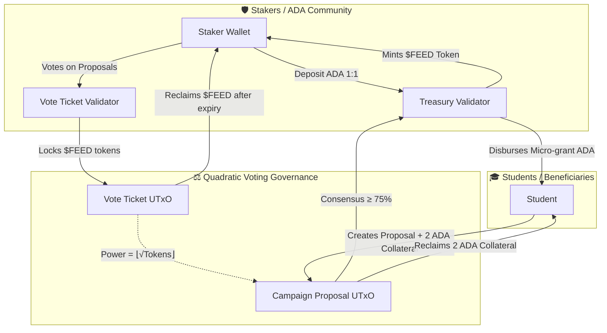

# 🍜 Feed Me — Cardano Community Canteen & Micro-Grant Protocol

[-blue?logo=cardano)](https://cardano.org/)
[](https://aiken-lang.org/)
[](https://meshjs.dev/)
[](https://nextjs.org/)
[](https://turbo.build/)
[](https://opensource.org/licenses/MIT)

> **"No student goes hungry on campus."**
> A decentralized mobile-first personal micro-grant & liquid staking pool dApp on Cardano. Stakers earn Cardano staking rewards while creating a community safety net; students request emergency meal support; the community governs allocations transparently via **Quadratic Voting**.

---

## 📖 Table of Contents

- [Vision & Architecture](#-vision--architecture)
- [Protocol Mechanics](#-protocol-mechanics)
  - [1. Liquid Staking ($FEED)](#1-liquid-staking-feed)
  - [2. Anti-Spam Collateral](#2-anti-spam-collateral)
  - [3. Quadratic Voting Governance](#3-quadratic-voting-governance)
  - [4. Reference Input Disbursal](#4-reference-input-disbursal)
- [Monorepo Structure](#-monorepo-structure)
- [Smart Contracts & On-Chain Audit](#-smart-contracts--on-chain-audit)
- [Quickstart Guide](#-quickstart-guide)
  - [Prerequisites](#prerequisites)
  - [Installation](#installation)
  - [Running On-Chain Contract Tests](#running-on-chain-contract-tests)
  - [Running Off-Chain SDK & E2E Tests](#running-off-chain-sdk--e2e-tests)
  - [Running the Next.js Web App](#running-the-nextjs-web-app)
- [Cardano Preview Testnet Setup](#-cardano-preview-testnet-setup)
- [License](#-license)

---

## 🌟 Vision & Architecture

Feed Me bridges decentralized finance (DeFi) with tangible real-world social impact by turning ADA staking yields into emergency meal vouchers for students in need.



---

## ⚙️ Protocol Mechanics

### 1. Liquid Staking (`$FEED`)
- **1:1 Minting**: Users deposit ADA into the decentralized `Treasury` contract and immediately receive `$FEED` liquid staking tokens 1:1.
- **Redemption**: Stakers can burn `$FEED` at any epoch to redeem their principal ADA back.
- **Yield Generation**: Staked ADA earns standard Cardano PoS delegation rewards, replenishing the meal voucher pool continuously without depleting community principal.

### 2. Anti-Spam Collateral
- To prevent spam proposals on Cardano Preview Testnet and Mainnet, students deposit **2 ADA collateral** when publishing a campaign.
- Once the proposal concludes (approved or rejected after the deadline), the 2 ADA collateral is **100% refunded** to the student.

### 3. Quadratic Voting Governance
- Standard 1-token-1-vote systems allow whales to dominate funding decisions. Feed Me implements **Quadratic Voting (QV)** on-chain:
  $$\text{Voting Power} = \lfloor\sqrt{\text{Tokens Locked}}\rfloor$$
  - $100\ \$FEED \longrightarrow 10\ \text{Votes}$
  - $64\ \$FEED \longrightarrow 8\ \text{Votes}$
  - $16\ \$FEED \longrightarrow 4\ \text{Votes}$
  - $4\ \$FEED \longrightarrow 2\ \text{Votes}$
  - $1\ \$FEED \longrightarrow 1\ \text{Vote}$
- Votes are locked in a dedicated `vote_ticket` UTxO until the voting round concludes, preventing double-voting attacks.
- A campaign is approved when it achieves a **$\ge 75\%$ consensus threshold**:
  $$yes\_votes \times 100 \ge total\_votes \times 75$$

### 4. Reference Input Disbursal
- Using **Plutus V3 Reference Inputs** (`readOnlyTxInReference`), the Treasury contract authenticates that the campaign reached valid consensus without consuming or locking the campaign UTxO, eliminating transaction concurrency bottlenecks.

---

## 📂 Monorepo Structure

```text
feed-me/
├── apps/
│   └── web/                     # Next.js 15 Web Application (Tailwind CSS, MeshJS React)
│       ├── src/
│       │   ├── app/             # App Router pages (/create, /treasury, /votes)
│       │   ├── components/      # UI Components (Canteen theme, WalletModal, VoteModal)
│       │   └── data/            # Mock proposals & protocol state
│       └── next.config.mjs      # Webpack async WASM & security headers
├── packages/
│   ├── contracts/               # Aiken Plutus V3 Smart Contracts
│   │   ├── validators/          # treasury.ak, campaign.ak, vote_ticket.ak
│   │   ├── aiken.toml           # Aiken package configuration
│   │   ├── plutus.json          # Compiled Plutus V3 blueprint
│   │   └── AUDIT.md             # Security review & Execution Units benchmark
│   └── offchain/                # MeshJS Off-chain SDK & Transaction Builders
│       ├── src/                 # mesh-tx-builder.ts, blueprint-loader.ts
│       └── test/                # Aiken simulation tests & 8-step E2E integration test
├── turbo.json                   # Turborepo pipeline configuration
└── pnpm-workspace.yaml          # pnpm workspace definition
```

---

## 🔒 Smart Contracts & On-Chain Audit

All validators are written in **Aiken** and target **Cardano Plutus V3 (Conway era)**:

| Validator | Type | Description | Max Mem Used | Max CPU Used |
| :--- | :--- | :--- | :--- | :--- |
| `treasury.ak` | Spend | Manages pooled community ADA & micro-grant payouts | `222,021` (<1.6%) | `74,149,180` (<0.8%) |
| `treasury.ak` | Mint | Mints/burns `$FEED` liquid staking tokens 1:1 | `61,720` (<0.5%) | `18,106,129` (<0.2%) |
| `campaign.ak` | Spend | Proposal lifecycle & 2 ADA collateral refund | `116,076` (<0.9%) | `38,823,950` (<0.4%) |
| `vote_ticket.ak` | Spend | Timelocked Quadratic Voting ticket vault | `94,480` (<0.7%) | `29,108,219` (<0.3%) |

> Comprehensive security analysis and CEK machine benchmarks can be found in [`packages/contracts/AUDIT.md`](packages/contracts/AUDIT.md).

---

## 🚀 Quickstart Guide

### Prerequisites
- **Node.js**: `v20.x` or higher
- **pnpm**: `v9.x` or higher
- **Aiken**: `v1.1.15` or higher ([Installation Guide](https://aiken-lang.org/installation-instructions))
- **Cardano Wallet**: [Eternl](https://eternl.io/), [Lace](https://www.lace.io/), or [Vespr](https://vespr.xyz/) (switched to **Preview Testnet**)

### Installation

```bash
# Clone the repository
git clone https://github.com/bunsuonkhonghanh1810/feed-me.git
cd feed-me

# Install monorepo dependencies
pnpm install
```

### Running On-Chain Contract Tests

```bash
cd packages/contracts
aiken check
```
*Expected: 40/40 tests passing with detailed execution unit traces.*

### Running Off-Chain SDK & E2E Tests

```bash
# From workspace root
pnpm --filter @feed-me/offchain test
```
*Expected: 20/20 test suites passing (including the 8-step protocol lifecycle E2E flow).*

### Running the Next.js Web App

```bash
# From workspace root
pnpm --filter web dev
```
Open [http://localhost:3000](http://localhost:3000) in your browser.

To verify a production build:
```bash
pnpm --filter web build
```

---

## 🌐 Cardano Preview Testnet Setup

1. **Get Preview Testnet ADA**:
   - Request test ADA from the official [Cardano Testnets Faucet](https://docs.cardano.org/cardano-testnets/tools/faucet/).
2. **Configure your Browser Wallet**:
   - In Eternl or Lace settings, switch the active network from `Mainnet` to `Preview`.
   - Enable **Collateral** (5 ADA) in your wallet settings to interact with Plutus V3 smart contracts.
3. **Connect & Transact**:
   - Click **"Kết nối ví" (Connect Wallet)** on the Feed Me top navbar.
   - Deposit ADA in **Treasury Hub** to mint `$FEED`.
   - Vote on campus proposals with **Quadratic Voting** on **Feed Me Wall**.
   - Create emergency meal proposals with 2 ADA refundable collateral on **Tạo Đề Xuất**.

---

## 📄 License

This project is licensed under the [MIT License](LICENSE).
